# JobPortal

JobPortal, iş arayanlarla ilan veren şirketleri bir araya getiren bir iş ilanı platformudur. Adaylar ilanları arayıp filtreleyebilir, tek adımda başvurabilir, özgeçmiş profillerini yönetebilir ve şirketleri değerlendirebilir. Yöneticiler ilanları, şirketleri ve çalışma alanlarını tek bir panelden yönetir. Yeni bir ilan yayınlandığında bütün kullanıcılara arka planda bildirim gönderilir.

Proje iki parçadan oluşur:

- **Backend:** ASP.NET Core 8 ile katmanlı mimaride yazılmış bir REST API.
- **Frontend:** React 19 ve TypeScript ile geliştirilmiş tek sayfalık bir web uygulaması.

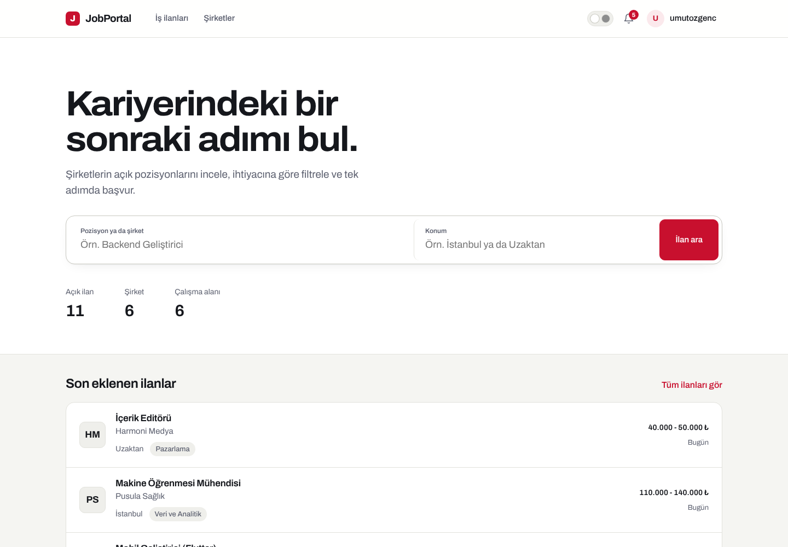

## İçindekiler

- [Teknolojiler](#teknolojiler)
- [Mimari](#mimari)
- [Backend katmanları](#backend-katmanları)
- [Teknolojilerin projede kullanımı](#teknolojilerin-projede-kullanımı)
- [Frontend](#frontend)
- [API](#api)
- [Ekran görüntüleri](#ekran-görüntüleri)

## Teknolojiler

| Alan | Teknoloji |
| --- | --- |
| Çatı | .NET 8, ASP.NET Core Web API |
| Veri erişimi | Entity Framework Core 8, SQL Server 2022 |
| Kimlik doğrulama | ASP.NET Core Identity, JWT Bearer, refresh token |
| Önbellek | Redis (StackExchange.Redis, `IDistributedCache`) |
| Mesajlaşma | RabbitMQ (RabbitMQ.Client) |
| Dosya depolama | Cloudinary |
| Doğrulama | FluentValidation |
| Nesne eşleme | AutoMapper |
| API sürümleme | Asp.Versioning |
| Dokümantasyon | Swagger (Swashbuckle) |
| Yapılandırma | `.env` (DotNetEnv), `appsettings.json` |
| Altyapı | Docker Compose (SQL Server, Redis, RabbitMQ) |
| Frontend | React 19, TypeScript, Vite 6, React Router 7, Motion |

## Mimari

Sistem dört dış bileşenle çalışır. Tarayıcıdaki React uygulaması isteklerini `/api` yolundan API'ye iletir. API verileri SQL Server'da tutar, sık okunan şirket verilerini Redis'te önbelleğe alır, bildirim işlerini RabbitMQ kuyruğuna bırakır ve görselleri Cloudinary'ye yükler.

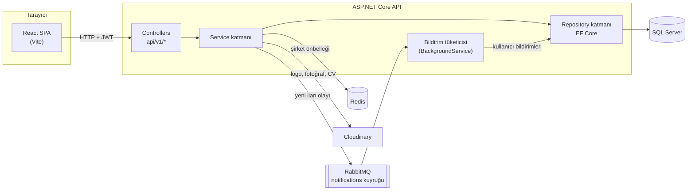

### Çözüm yapısı

```
JobPortalApp
├── JobPortalApp.Api            HTTP katmanı: controller'lar, uygulama başlangıcı, middleware
├── JobPortalApp.Service        İş kuralları, DTO eşleme, doğrulama, token üretimi, RabbitMQ
├── JobPortalApp.Repository     EF Core DbContext, entity yapılandırmaları, migration'lar, repository'ler
├── JobPortalApp.Model          Entity'ler ve DTO'lar (request / response modelleri)
├── JobPortalApp.Shared         Ortak altyapı: ServiceResult, generic repository, cache, Cloudinary, roller
├── frontend/JobPortalApp.Web   React + TypeScript web uygulaması
├── docker-compose.yml          SQL Server, Redis ve RabbitMQ servisleri
└── .env.example                Ortam değişkenleri şablonu
```

Bağımlılıklar tek yönlüdür: `Api → Service → Repository → Model → Shared`. Her katman, kendi servis kayıtlarını bir extension metodu üzerinden yapar. `Program.cs` bu metotları zincirleyerek uygulamayı ayağa kaldırır:

```csharp
builder.Services.AddRepositoryExtensions(builder.Configuration)
    .AddServiceExtensions(typeof(ServiceAssembly), builder.Configuration)
    .AddSharedExtension(builder.Configuration);
```

## Backend katmanları

### Model

Model katmanı her iş alanını kendi klasöründe tutar: `Categories`, `Companies`, `JobPostings`, `JobApplications`, `Notifications`, `Users`. Her klasörde iki alt klasör vardır:

- **`Entities`:** veritabanı tablolarını temsil eden sınıflar.
- **`Dtos`:** API'nin dışarıya açtığı modeller. İstekler `record` tipinde tanımlanır (örneğin `CreateJobPostingRequest`), yanıtlar `init`-only özelliklere sahip DTO'lardır (örneğin `JobPostingDto`).

Entity'ler `BaseEntity<TId>` sınıfından türer. Oluşturulma ve güncellenme zamanı tutulması gereken entity'ler ayrıca `IAuditEntity` arayüzünü uygular. Anahtar türleri iş alanına göre seçilmiştir:

- **`int`:** kategoriler ve şirketler.
- **`Guid`:** ilanlar, başvurular ve bildirimler. Değerler NewId ile sıralı üretilir.
- **`string`:** Identity kullanıcıları.

### Repository

- **`AppDbContext`:** `IdentityDbContext<User, IdentityRole, string>` sınıfından türer. Entity yapılandırmalarını `ApplyConfigurationsFromAssembly` ile kendi assembly'sinden toplar.
- **Fluent API yapılandırmaları:** her entity için `IEntityTypeConfiguration<T>` ile ayrı bir sınıfta yazılır. Kolon uzunlukları, ilişkiler, silme davranışları (`Cascade` / `Restrict`) ve otomatik `Include` edilecek navigasyonlar (`AutoInclude`) burada tanımlanır.
- **Repository'ler:** `GenericRepository<TDbContext, TEntity, TId>` temel CRUD işlemlerini ve sorgulanabilir `Where` metodunu sağlar. Alana özel sorgular kendi repository sınıflarında yazılır, örneğin `GetApplicationsByUserIdAsync`.
- **`IUnitOfWork`:** değişiklikleri tek bir `SaveChangesAsync` çağrısıyla kalıcı hale getirir.
- **`AuditDbContextInterceptor`:** bir `SaveChangesInterceptor`'dır. Kaydedilen her `IAuditEntity` için `CreatedAt` ve `UpdatedAt` alanlarını UTC olarak otomatik doldurur.
- **Migration'lar:** veritabanı şeması EF Core migration'larıyla yönetilir. Development ortamında uygulama açılırken bekleyen migration'lar otomatik uygulanır.

### Service

Her iş alanının servisi bir arayüz (`Abstracts`) ve bir uygulamadan (`Concretes`) oluşur. Servisler her zaman `ServiceResult` ya da `ServiceResult<T>` döndürür. Bu nesne üç şey taşır:

- veri,
- hata mesajları,
- HTTP durum kodu (JSON'a yazılmaz).

Böylece controller'lar iş kurallarından habersiz kalır ve yalnızca sonucu HTTP yanıtına çevirir.

Servis katmanında yer alan iş kurallarına örnekler:

- İlan oluşturulurken şirketin ve alanın var olduğu kontrol edilir. Pasif ilanlar herkese açık listelerde gösterilmez.
- Bir kullanıcı aynı ilana yalnızca bir kez başvurabilir. Kapalı ilanlara başvuru alınmaz.
- Bir kullanıcı her şirket için tek değerlendirme yapabilir. Değerlendirmeyi yalnızca sahibi düzenleyebilir; sahibi ya da yönetici silebilir.
- İçinde ilan bulunan bir çalışma alanı silinemez.
- Özgeçmiş profilleri kullanıcı başına tektir. Kimlik her zaman JWT içindeki kullanıcıdan alınır.

### Api

- **`CustomBaseController`:** bütün controller'ların ortak tabanıdır. `[ApiController]`, `api/v{version}/[controller]` rotası ve sürüm bilgisi burada tanımlanır. `CreateActionResult` metodu `ServiceResult`'ı uygun HTTP yanıtına (200, 201, 204, 400, 403, 404…) dönüştürür.
- **Yetkilendirme:** attribute'larla yapılır.
  - Okuma uçları (ilanlar, şirketler, kategoriler, değerlendirmeler) herkese açıktır.
  - Kullanıcıya ait uçlar `[Authorize]` ile korunur.
  - Yönetim uçları `[Authorize(Roles = AppRoles.Administrators)]` ile korunur.
- **Kullanıcı kimliği:** controller'larda `ClaimsPrincipal` üzerindeki `GetUserId()` uzantısıyla token'dan okunur. İstek gövdesinden kullanıcı kimliği alınmaz.
- **`GlobalExceptionHandler`:** .NET 8'in `IExceptionHandler` arayüzünü uygular. Yakalanmamış hataları loglar ve istemciye her zaman aynı `ServiceResult` formatında yanıt döner.
- **Doğrulama hataları:** `ApiBehaviorOptions.InvalidModelStateResponseFactory` ile aynı formata çevrilir. Böylece frontend tek bir hata yapısını işler.
- **`DatabaseInitializer`:** açılışta rolleri (`Admin`, `SuperAdmin`, `User`) oluşturur ve `.env` dosyasındaki bilgilerle yönetici hesabını hazırlar.

## Teknolojilerin projede kullanımı

### Entity Framework Core ve SQL Server

SQL Server, Docker Compose ile ayağa kalkan `mcr.microsoft.com/mssql/server:2022-latest` imajında çalışır. EF Core bu veritabanına Repository katmanındaki `AppDbContext` üzerinden erişir.

İlişkiler Fluent API ile tanımlanmıştır:

- Bir şirketin ilanları ve değerlendirmeleri vardır. Şirket silinirse bunlar da silinir.
- Her ilan bir şirkete ve bir çalışma alanına bağlıdır. İçinde ilan olan bir alanın silinmesi engellenir.
- Başvurular hem kullanıcıya hem ilana bağlıdır.
- Her kullanıcının en fazla bir özgeçmiş profili vardır.

İlan listeleme, `IQueryable` üzerinde birden fazla koşulun birleştirilmesiyle yapılır. Arama, konum, alan ve şirket filtreleri sırayla eklenir; ardından `CountAsync` ile toplam sayı alınır ve `Skip` / `Take` ile sayfalama uygulanır. Sonuç `PagedResult<T>` olarak döner. Bu nesne sayfa öğelerinin yanında sayfa numarasını, sayfa boyutunu, toplam kayıt sayısını ve toplam sayfa sayısını içerir.

### ASP.NET Core Identity ve JWT

- **Kullanıcılar ve roller:** ASP.NET Core Identity ile yönetilir. Entity `User`, `IdentityUser` sınıfından türer. Başarısız giriş denemelerinde Identity'nin hesap kilitleme (lockout) mekanizması devreye girer.
- **Access token:** `TokenService` tarafından HMAC-SHA256 ile imzalanan kısa ömürlü bir JWT'dir. İçinde kullanıcı kimliği, e-posta, kullanıcı adı ve roller taşınır.
- **Refresh token:** 32 baytlık rastgele bir değer olarak üretilir ve `UserRefreshTokens` tablosunda son kullanma tarihiyle saklanır. Her yenilemede yeni bir çiftle değiştirilir, kullanılan eski token geçersiz olur.
- **Token doğrulama:** API, `AddJwtBearer` ile issuer, audience, imza ve süre kontrolü yapar. Issuer, audience ve süreler `appsettings.json`'da, imza anahtarı `.env`'de tutulur.

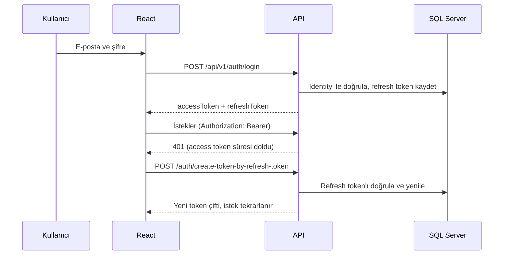

### Redis

Redis, `Microsoft.Extensions.Caching.StackExchangeRedis` ile `IDistributedCache` olarak kaydedilir. Bunun üzerine `JobPortalApp.Shared/Caching` altında `ICacheService` adlı ince bir katman vardır. Bu katman:

- nesneleri JSON olarak yazar ve okur,
- Redis'e ulaşılamadığında hatayı loglar,
- isteği hata vermeden veritabanına yönlendirir.

Şirket listesi ve şirket detayları DTO olarak `companies:all` ve `companies:{id}` anahtarlarıyla önbelleğe alınır. Şirket eklendiğinde, güncellendiğinde ya da silindiğinde ilgili anahtarlar temizlenir.

### RabbitMQ

Yeni bir ilan yayınlandığında `JobPostingService`, `NotificationPublisher` aracılığıyla `notifications` kuyruğuna kalıcı (persistent) bir mesaj bırakır. HTTP isteği bildirimlerin yazılmasını beklemez.

Mesajları `NotificationConsumerBackgroundService` işler. Bu sınıf bir `BackgroundService`'tir ve şöyle çalışır:

1. `AsyncEventingBasicConsumer` ile kuyruğu dinler.
2. Gelen her mesaj için yeni bir DI scope açar.
3. Bütün kullanıcılara bildirim kaydı oluşturur.
4. İşlem başarılıysa mesajı `BasicAck` ile onaylar.

Bağlantı `RabbitMQClient` sınıfında tembel (lazy) olarak kurulur ve otomatik kurtarma (automatic recovery) açıktır. RabbitMQ henüz hazır değilse tüketici belirli aralıklarla yeniden bağlanmayı dener.

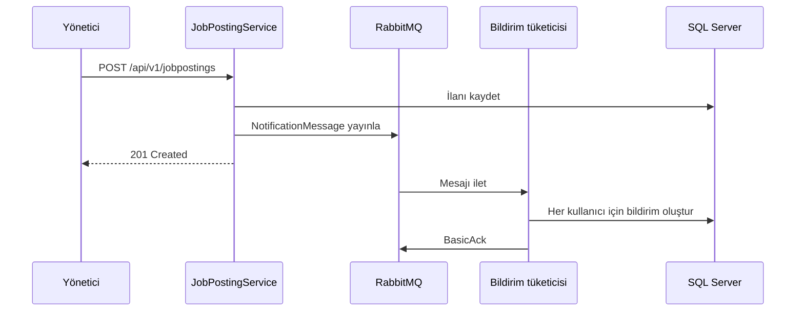

### Cloudinary

Şirket logoları, profil fotoğrafları ve PDF özgeçmişler `ICloudinaryService` üzerinden Cloudinary'ye yüklenir:

- Görseller `ImageUploadParams` ile yüklenir.
- PDF'ler `RawUploadParams` ile yüklenir.
- Veritabanında yalnızca dosyanın HTTPS adresi (`SecureUrl`) saklanır.

Dosya türü ve boyutu yüklemeden önce `FileRules` yardımcı sınıfıyla doğrulanır. Görseller en fazla 2 MB, PDF'ler en fazla 5 MB olabilir. Formlar `multipart/form-data` olarak gönderilir.

### FluentValidation ve AutoMapper

- **FluentValidation:** her istek modelinin bir doğrulayıcısı vardır (örneğin `CreateJobPostingRequestValidator`). Doğrulayıcılar `AddValidatorsFromAssemblyContaining` ile otomatik kaydedilir ve `AddFluentValidationAutoValidation` sayesinde controller'a ulaşmadan çalışır.
- **AutoMapper:** entity ↔ DTO dönüşümleri her alanın kendi `Profile` sınıfında tanımlanır. İlişkili alanlar `ForMember` ile düzleştirilir, örneğin `JobPosting.Company.Name → JobPostingDto.CompanyName`. Güncelleme isteklerinde kimlik ve dosya alanları `Ignore` ile korunur.

### API sürümleme ve Swagger

Asp.Versioning ile URL segmenti tabanlı sürümleme kullanılır. Bütün uçlar `api/v1/...` altında yer alır. Swagger, Development ortamında API dokümantasyonu sunar ve JWT ile yetkilendirme için bir "Authorize" alanı içerir.

### Yapılandırma ve Docker Compose

Gizli bilgiler kaynak kodda ya da `appsettings` dosyalarında tutulmaz; hepsi solution kökündeki `.env` dosyasındadır. Bu bilgiler şunlardır:

- veritabanı, Redis ve RabbitMQ bağlantı adresleri,
- JWT imza anahtarı,
- Cloudinary anahtarları,
- yönetici hesabı.

API açılırken `DotNetEnv` bu dosyayı ortam değişkeni olarak yükler. Değişken adlarında `__` iç içe yapılandırmayı temsil eder (`ConnectionStrings__SqlServer → ConnectionStrings:SqlServer`). Gerekli bir değer eksikse uygulama hangi anahtarın eksik olduğunu belirten bir hatayla durur.

Docker Compose aynı `.env` dosyasını okuyarak üç servisi ayağa kaldırır: SQL Server, Redis ve RabbitMQ (yönetim arayüzüyle birlikte). Container şifreleri doğrudan bu değişkenlerden gelir.

## Frontend

Web uygulaması `frontend/JobPortalApp.Web` altındadır. Vite ile geliştirilir ve TypeScript'in strict moduyla yazılmıştır.

```
src
├── api           fetch tabanlı istemci, uç noktalar ve tipler
├── auth          AuthContext (oturum, kullanıcı, roller) ve RequireAuth koruması
├── notifications NotificationsContext (okunmamış sayacı, periyodik yenileme)
├── theme         Açık / koyu tema
├── components    Header, JobRow, SearchBar, Modal, Rating, Pagination…
├── pages         Sayfalar ve admin/ altındaki yönetim ekranları
├── lib           Tarih biçimlendirme ve hata mesajı çevirileri
└── styles        Tasarım tokenları ve bileşen stilleri
```

- **API istemcisi (`api/client.ts`):** bütün istekleri `/api/v1` üzerinden gönderir ve access token'ı `Authorization` başlığına ekler. 401 yanıtı alındığında refresh token ile yeni bir token çifti alıp isteği bir kez tekrarlar. Aynı anda gelen birden fazla 401 için tek bir yenileme isteği yapılır.
- **API bağlantısı:** geliştirme sırasında Vite'ın proxy özelliği `/api` isteklerini API'ye yönlendirir. Böylece tarayıcı ve API aynı kaynaktan konuşuyormuş gibi çalışır.
- **Yönlendirme:** React Router 7 ile yapılır. Arama ve filtre durumu adres çubuğundaki sorgu parametrelerinde tutulur (`/ilanlar?ara=react&kategori=1&sayfa=2`). Bu sayede filtrelenmiş sonuçlar paylaşılabilir ve geri tuşu beklendiği gibi çalışır.
- **Oturum:** `AuthContext` oturumu yönetir; yönetici yetkisi `/users/me` yanıtındaki rollerden çıkarılır. Korunan sayfalar `RequireAuth` bileşeniyle sarılır.
- **Bildirimler:** `NotificationsContext` bildirimleri periyodik olarak yeniler ve üst menüdeki zil simgesinde okunmamış sayısını gösterir.
- **Hata mesajları:** API'den gelen hata mesajları `lib/messages.ts` içindeki çeviri tablosuyla Türkçe gösterilir.
- **Tasarım:** sistem CSS değişkenleri üzerine kuruludur. Renkler, yüzeyler, çizgiler ve köşe yarıçapları token olarak tanımlanır; açık ve koyu tema bu tokenların `data-theme` özniteliğine göre yeniden tanımlanmasıyla çalışır. Yazı tipi olarak Archivo Variable, küçük geçiş animasyonları için Motion kullanılır.

## API

Bütün uçlar `api/v1` önekiyle sunulur.

| Kaynak | Uçlar | Erişim |
| --- | --- | --- |
| Kimlik | `POST auth/register`, `POST auth/login`, `POST auth/create-token-by-refresh-token`, `POST auth/revoke-refresh-token` | Herkes |
| Kullanıcı | `GET users/me`, `PUT users/me` | Oturum açmış kullanıcı |
| İlanlar | `GET jobpostings` (arama, filtre, sayfalama), `GET jobpostings/{id}` | Herkes |
| | `POST`, `PUT`, `DELETE jobpostings` | Yönetici |
| Başvurular | `POST jobapplications`, `GET jobapplications/by-user` | Oturum açmış kullanıcı |
| | `GET jobapplications/by-jobposting/{id}` | Yönetici |
| Şirketler | `GET companies`, `GET companies/{id}`, `GET companies/{id}/jobpostings` | Herkes |
| | `POST`, `PUT`, `DELETE companies` (multipart, logo) | Yönetici |
| Değerlendirmeler | `GET companyreviews/by-company/{companyId}` | Herkes |
| | `POST`, `PUT`, `DELETE companyreviews` | Sahibi; silmede yönetici de |
| Kategoriler | `GET categories` | Herkes |
| | `POST`, `PUT`, `DELETE categories` | Yönetici |
| Profil | `GET`, `PUT`, `DELETE userprofiles/me`, `POST userprofiles` (multipart, fotoğraf ve CV) | Oturum açmış kullanıcı |
| Bildirimler | `GET notifications`, `PUT notifications/{id}/read`, `PUT notifications/read-all` | Oturum açmış kullanıcı |
| Roller | `POST roles/CreateUserRoles/{userName}` | Yönetici |

Bütün yanıtlar aynı yapıdadır:

```json
{
  "data": { },
  "errorMessage": null,
  "message": null
}
```

## Ekran görüntüleri

### İş ilanları

Arama, çalışma alanı ve şirket filtreleri; sayfalı sonuç listesi.

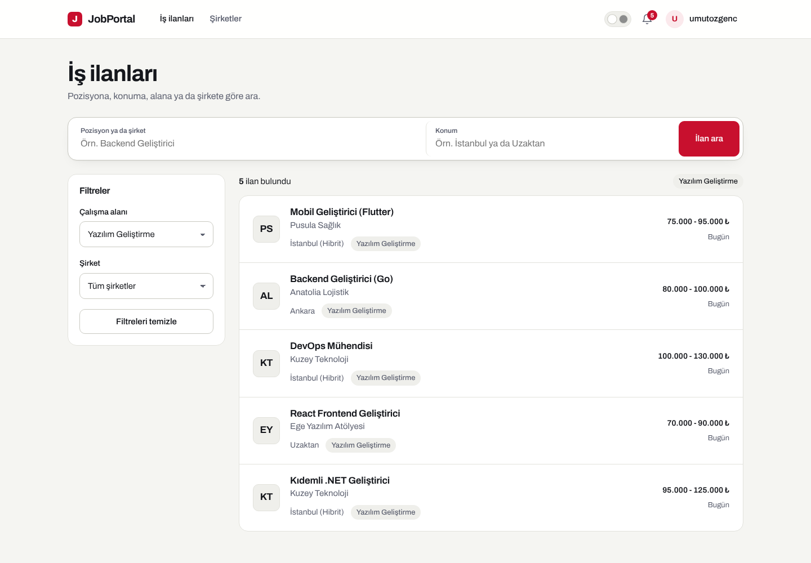

### İlan detayı ve başvuru

İş tanımı, ilan bilgileri ve başvuru durumu.

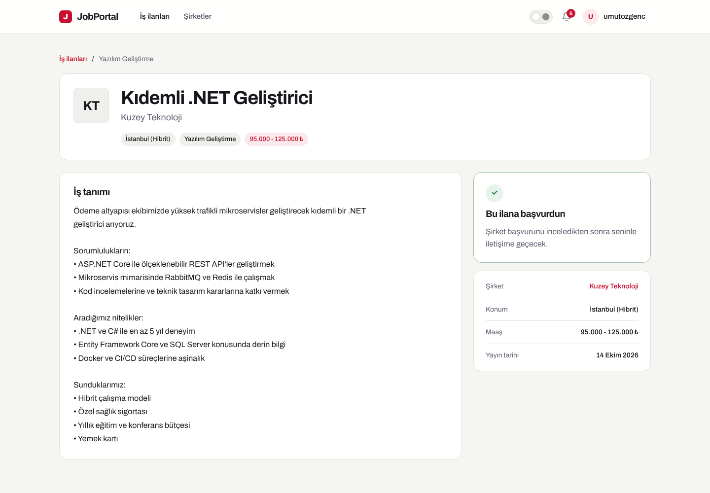

### Şirketler

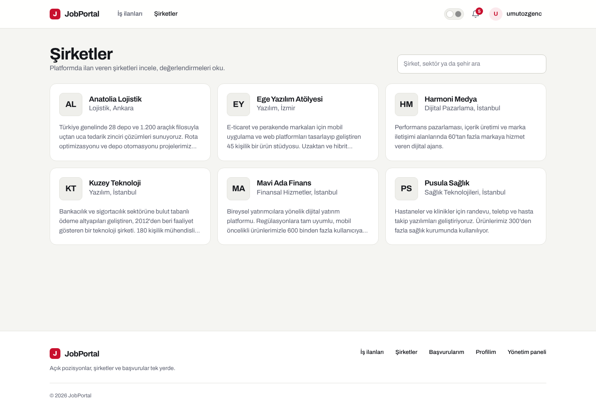

### Şirket sayfası ve değerlendirmeler

Şirket bilgileri, açık pozisyonlar ve yıldızlı kullanıcı değerlendirmeleri.

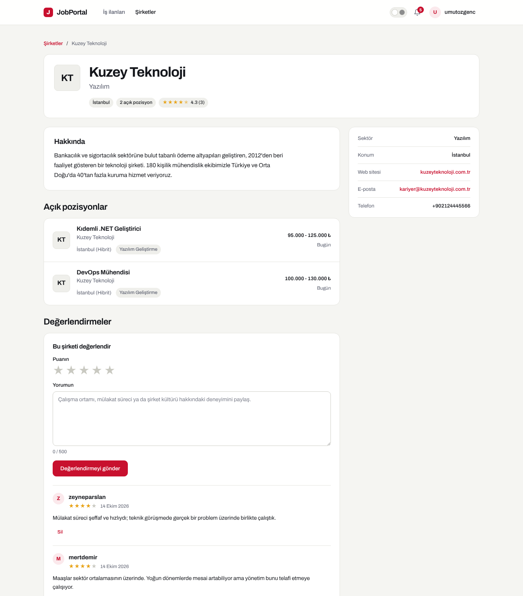

### Profil

Hesap bilgileri ve şirketlerin gördüğü özgeçmiş profili.

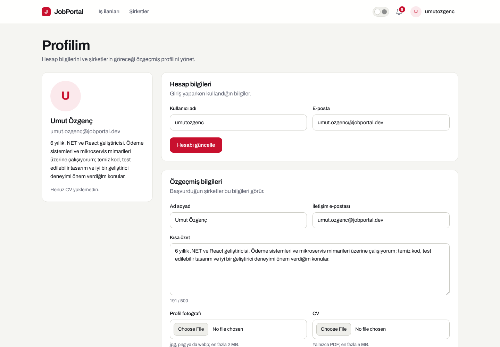

### Başvurularım

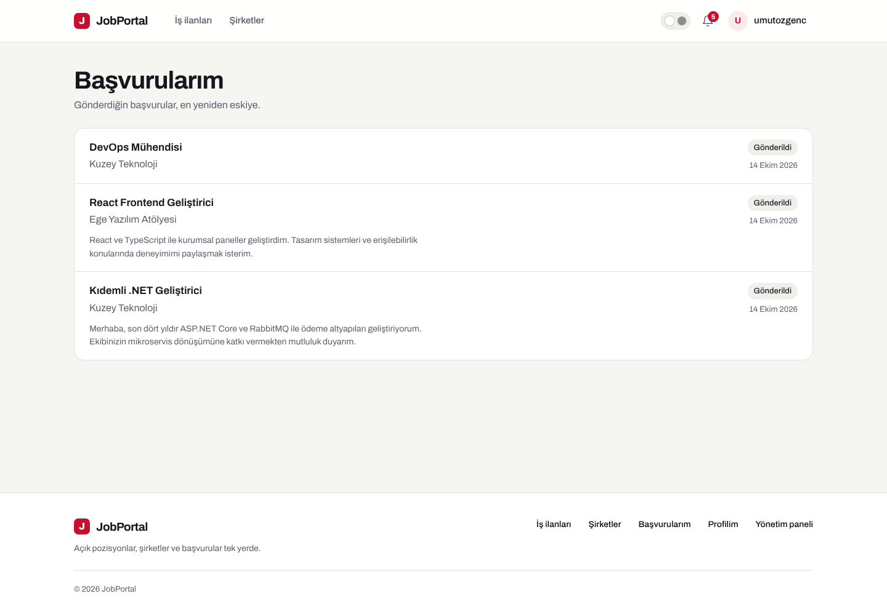

### Bildirimler

RabbitMQ üzerinden üretilen yeni ilan bildirimleri.

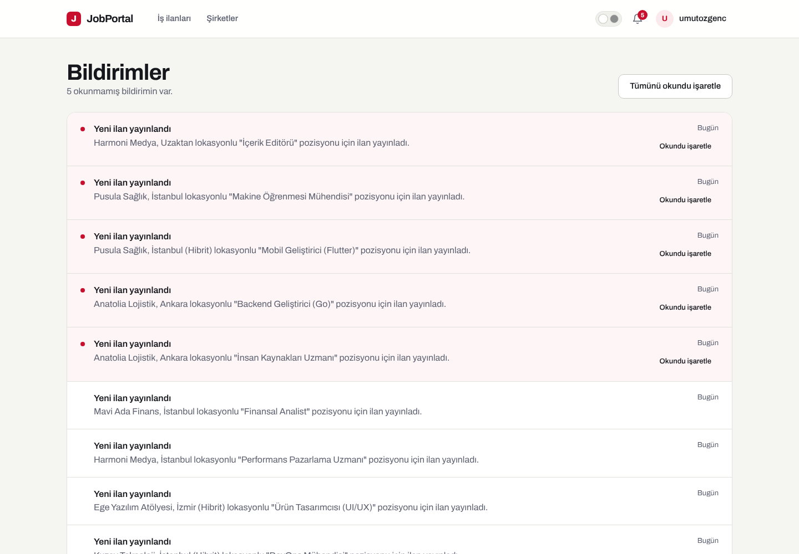

### Yönetim paneli

İlan yönetimi; düzenleme, yayından kaldırma, silme ve başvuranları görüntüleme.

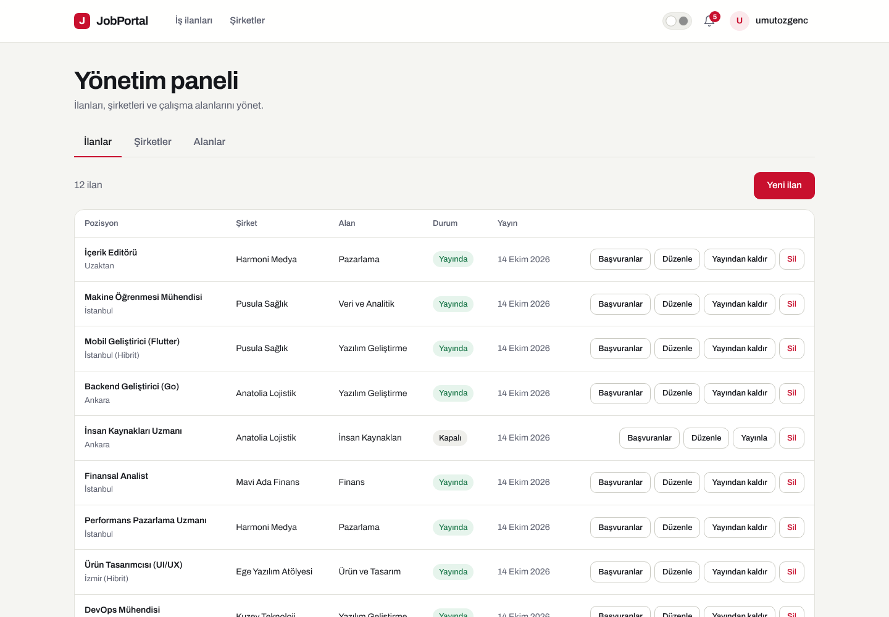

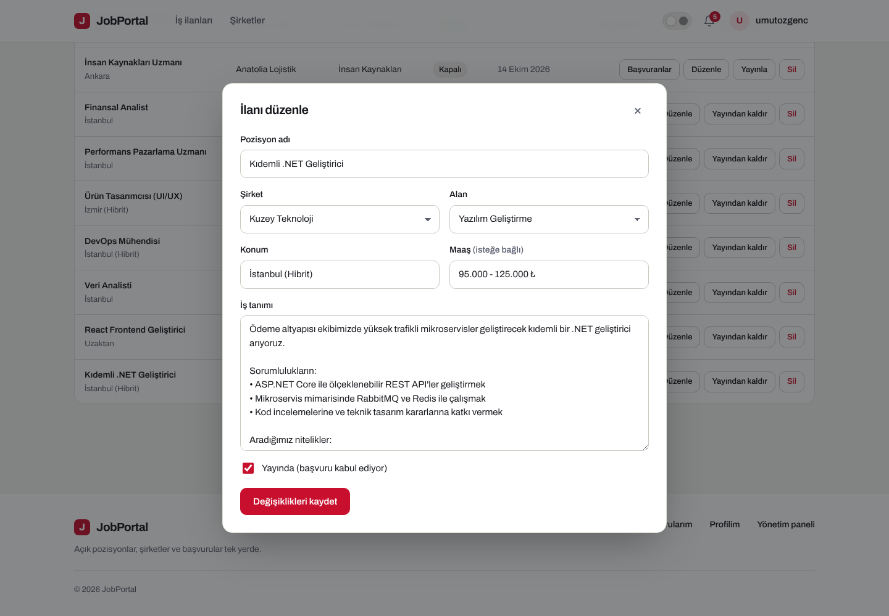

### Koyu tema

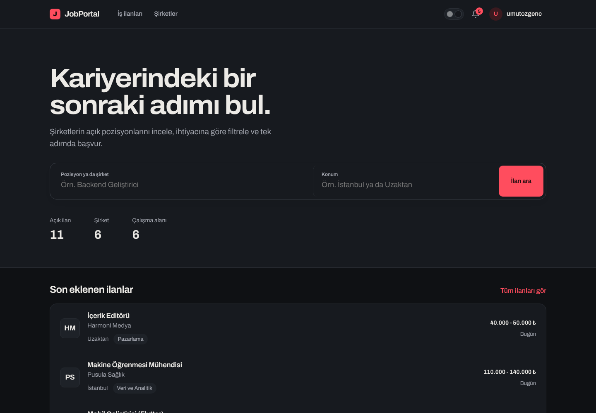

### Giriş

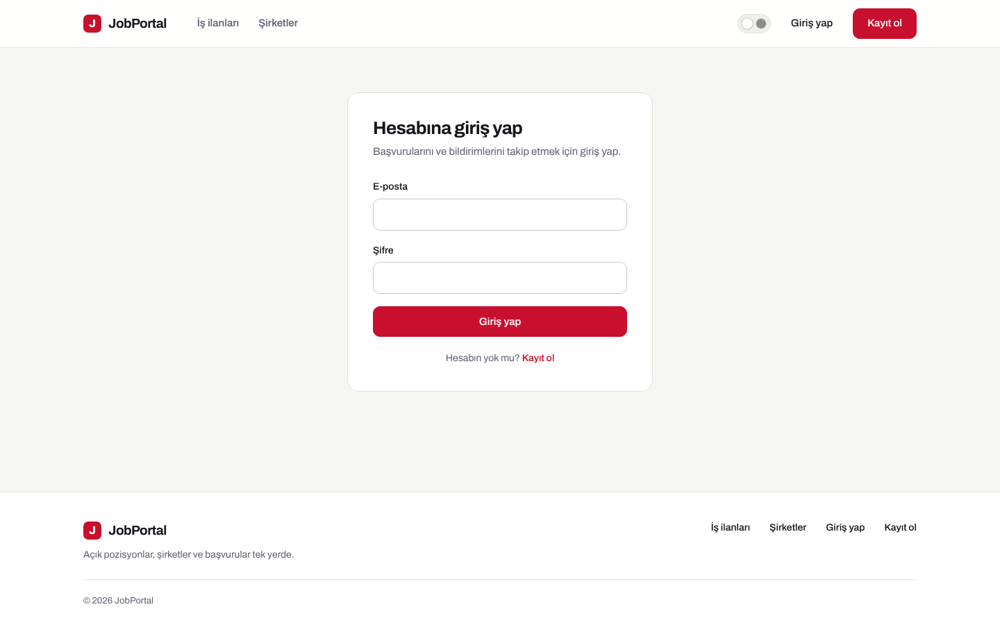

### Mobil görünüm

<p>
  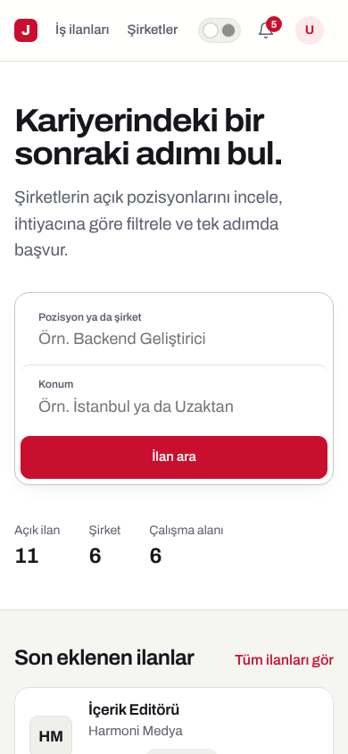
  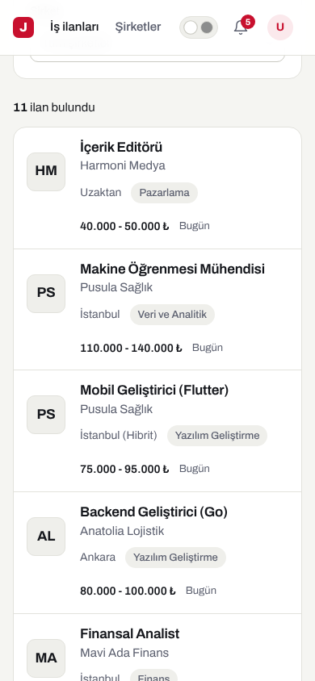
</p>
